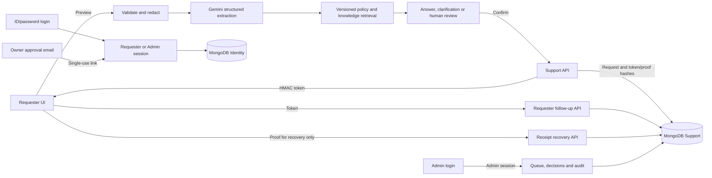
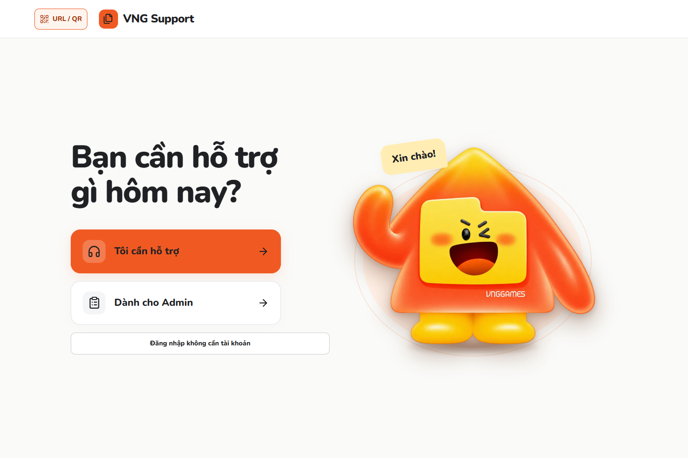
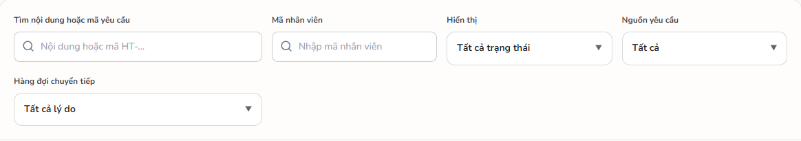
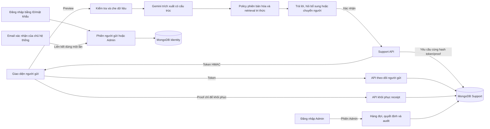

# NoSleepClub Support Desk

> **MLAI Hackathon 2026:** First Prize, VNG Track · Third Place Overall. [Results announcement](https://www.facebook.com/hutechuniversity/posts/pfbid02aDmtNL88SKFYwZUSW7gRMWut1BLRCKFEPxb2ZkhA3j2vRQx8P5epe2AaP63dhZ82l) · [Competition website](https://ai-network.hcmut.edu.vn/mlai2026)
>
> **Vietnamese below** · [Tiếng Việt](#phần-tiếng-việt)

NoSleepClub Support Desk is an AI-assisted help desk built for VNG’s **The Escalation Referee** challenge at MLAI Hackathon 2026. It turns natural-language support requests into reviewable workflows: resolve routine cases when policy and evidence permit, ask for missing information, and route risk or authority-sensitive cases to a human reviewer.

[](https://github.com/Tienkhoaa2908/NSC-helpdesk---MLAI-hackathon-2026/actions/workflows/qa.yml)
[](https://github.com/Tienkhoaa2908/NSC-helpdesk---MLAI-hackathon-2026/actions/workflows/reproducibility.yml)
[](https://nodejs.org/)
[](https://nextjs.org/)
[](https://react.dev/)
[](https://www.typescriptlang.org/)
[](https://www.mongodb.com/docs/drivers/node/current/)
[](https://ai.google.dev/gemini-api/docs)
[](docs/IDENTITY-SETUP.md)
[](https://vercel.com/docs/deployments/overview)
[](https://vitest.dev/)
[](https://playwright.dev/)

**Contents:** [My contributions](#my-contributions) · [Product workflow](#product-workflow) · [Architecture](#technical-architecture) · [Interface walkthrough](#interface-walkthrough) · [Run locally](#run-locally) · [Vietnamese](#phần-tiếng-việt)

## My contributions

### Policy-based request triage

I designed the policy runtime that converts structured request evidence into explainable decisions. The model extracts candidate facts into a validated contract; versioned server-side rules evaluate risk signals, authority, required information and routine handling conditions. Requests are classified as **ROUTINE**, **MISSING_INFO**, **BEYOND_AUTHORITY** or **SECURITY_RISK**. Cases that cannot be concluded carry an uncertainty label such as **MISSING_FACTS**, **OUT_OF_POLICY** or **AUTHORITY_REQUIRED**, along with a rationale and owner/team; a targeted requester or reviewer question is included where applicable. The model does not make the final policy decision or authorize an external action. This keeps model-assisted extraction, deterministic decision logic and human review as separate, testable parts of the workflow. The policy paths are checked against the 15-case judge dataset, the five-case Verify pack and regression tests; these are challenge checks, not a benchmark of live model quality. See [`policy-source.ts`](src/domain/policy-source.ts), [`policy.ts`](src/domain/policy.ts), the [judge cases](challenge/mlai-2026/data/verify/judge-15.json) and the [VNG Verify pack](challenge/mlai-2026/data/verify/support-v3.json).

### Requester and reviewer workflows

I contributed to the UI/UX design for request submission, preview and confirmation, follow-up and case tracking, as well as the Admin workspace for searching requests, inspecting evidence and recording actions. The requester interface presents guidance and status; reviewer-facing policy reasons and audit evidence stay in the review workflow. In-product guidance is organized around the task and role. Representative modules: [`support-workspace.tsx`](src/components/support-workspace.tsx), [`request-detail.tsx`](src/components/request-detail.tsx) and [`support-history.tsx`](src/components/support-history.tsx).

### Controlled grouping of related requests

Eligible requests are grouped by a recognized FAQ topic or a site-scoped incident. Each requester keeps a separate case and tracking link. For eligible reply groups, an Admin can send one shared message to the current group; the system redacts the message, rechecks group membership before saving, and shows the reply on each member's case. Separately, incident groups accept predefined progress updates and remain active for up to 24 hours. These workflows do not merge individual cases. This is a product extension beyond the VNG challenge brief. See [`support-groups.ts`](src/lib/support-groups.ts) and [`support-incidents.ts`](src/lib/support-incidents.ts).

## Product workflow

1. **Submit:** A requester describes an issue in free text or through a guided category form. The server validates the input, redacts supported sensitive patterns and asks the model for structured facts.
2. **Evaluate:** Deterministic policy checks the extracted facts, evidence, risk and authority. Retrieval provides approved support guidance. Missing or unsafe evidence leads to a clarification or human review; a model failure does not become an approval.
3. **Preview and confirm:** The requester reviews the proposed response and next step. The request is stored only after confirmation.
4. **Continue:** The requester uses a tracking capability link to read the response, answer a clarification, add context or request human help. Each saved request keeps its own conversation and history. The token gates requester follow-up routes; reviewer access is separately protected by an Admin session.
5. **Review and audit:** Admins filter the queue, inspect the request and its evidence, choose an available action, and review the resulting audit history. Related cases may also receive a shared incident update.

## Technical architecture

- **Application:** Next.js App Router, React and TypeScript.
- **Model assistance:** Gemini supports structured request extraction and response drafting through the model adapter. The server validates outputs and retains final policy control. Google Search grounding is optional and separately configured.
- **Policy and safety:** Versioned deterministic rules handle risk, missing facts, authority and routing. Retrieval uses the application knowledge base; source and answer checks run before guidance is shown.
- **Persistence:** MongoDB stores support requests, events, incident groups, Verify runs and Identity records. Support and Identity can use separate configured databases.
- **Employee access:** Applicants submit a name and email address. The owner views requests in an Admin-only session and can issue an account from a single-use email link. The email address becomes the login ID; the server generates a five-digit demo password and stores only its hash. Reviewer APIs require an Admin session. The public requester demo is `guest01 / 12345`; use synthetic data only.
- **Requester tracking:** The server derives a stable HMAC token from a dedicated secret and request ID; MongoDB stores only its hash. At submission, the browser also supplies a random recovery proof whose hash is stored separately. That proof is used only by the receipt-recovery endpoint after an ambiguous submission; tracking and follow-up routes require the token. Reviewer APIs have a separate Admin session boundary.
- **Audit and testing:** Request decisions and reviewer actions are represented in application history. Unit, integration and end-to-end tests cover policy and workflow behavior.



### Competition test cases

The challenge brief requires at least 15 test scenarios. The Verify page exposes five synthetic packs:

| Pack | Cases | Purpose |
| --- | ---: | --- |
| Judge dataset | 15 | Challenge scenarios covering missing information, out-of-policy requests, authority, security and mixed inputs. |
| Problem A / VNG | 5 | Three routine cases for automated guidance and two cases that must be escalated. |
| General | 4 | Shared challenge checks for routine guidance, missing information, scoped access and a public RDP risk. |
| Cache | 42 | Repeated and paraphrased FAQ requests plus controls to check cache hit, miss and bypass behavior. |
| Expansion | 30 | IT, HR and Commercial examples covering routine guidance, missing facts and human escalation. |

The 15-case judge dataset and five-case VNG pack satisfy the competition’s scenario and verification requirements. The remaining packs support general regression, cache and cross-department checks. All are synthetic application tests, not an independent benchmark of live model quality. See the [challenge brief](challenge/mlai-2026/CHALLENGE-BRIEF.md) and [MLAI dataset notes](challenge/mlai-2026/README.md).

## Interface walkthrough

The screenshots below were captured from the [official live deployment](https://nsclub-support-desk.vercel.app), not from another repository.

### Role selection



The home page directs requesters and Admin reviewers to their login flows. Visitors can sign in with the published demo credentials `guest01 / 12345` to try the requester workflow; use synthetic data only.

### Requester intake and follow-up


Requesters can describe the issue freely or select a support category. The form asks for only the context needed to route and assess the request; a preview is shown before a saved case is created.


The requester guide explains how to review a response, confirm or revise it, then use the case link to answer a clarification or continue the conversation. If the system lacks sufficient evidence or model assistance is unavailable, the policy path can ask for more information or route the case for human review instead of claiming it was resolved.

### Admin review and audit



The Admin workspace supports filtering and opening a case to inspect its evidence, policy outcome and history before taking an available action. Decisions are recorded for later review.


The Admin guide covers queue triage, reviewer actions, incident updates and Verify. Support review and audit APIs require an Admin session. The owner-only identity request list is read-only; account issuance happens from a single-use link in the owner’s email. The applicant receives their email address as the login ID and a random five-digit demo password. Opening the link acts immediately and may be triggered by an email security scanner. This demo is not a substitute for an organization’s IAM or HR verification process.

## Run locally

Requires Node.js 22.13 or later in the 22.x line, or 24 or later, and npm. Node 23 is excluded by dependency engine ranges.

```powershell
npm ci
if (-not (Test-Path .env.local)) { Copy-Item .env.example .env.local }
npm run dev
```

Open `http://localhost:3000`. The example environment uses mock AI and demo storage. To enable Gemini, set `AI_PROVIDER="gemini"`, `AI_MODEL` and `GEMINI_API_KEY` in `.env.local`. Keep API keys out of Git, browser code and chat. See [AI configuration](docs/AI-CONFIGURATION.md) and the [runbook](RUNBOOK.md).

## Checks

```powershell
npm run check:docs
npm run lint
npm run typecheck
npm test
npm run build
```

The full release and persistence checks are documented in the [runbook](RUNBOOK.md).
CI runs unit tests, documentation checks, lint, type checking, production build and desktop/mobile end-to-end tests. A separate workflow runs clean `npm ci` on Linux and Windows. Mongo restart persistence is opt-in in hosted CI and is skipped unless an isolated test URI and acknowledgement are configured; a passing badge does not claim live Mongo restart verification.

## Documentation

- [Requester guide](docs/EMPLOYEE-GUIDE.md) · [Admin guide](docs/ADMIN-GUIDE.md)
- [Architecture](docs/ARCHITECTURE.md) · [Evaluation and limitations](docs/EVALUATION.md)
- [Gemini configuration and key handling](docs/AI-CONFIGURATION.md) · [Employee login and account setup](docs/IDENTITY-SETUP.md)
- [MLAI 2026 challenge workspace and datasets](challenge/mlai-2026/README.md)
- [Documentation index](docs/README.md)

## Demo scope

This is a demonstration system, not organization-wide IAM. Account applications collect a user-supplied name and email; the address is not independently verified before issuance. The owner-only request list and Support review APIs require an Admin session. Approval links issue immediately when opened and can be fetched by email security scanners; they are single-use and expire after one hour. The public requester demo uses `guest01 / 12345`, and five-digit passwords are for synthetic demonstrations only. Do not submit real support cases or company-confidential data.

## Original competition repository

The team repository submitted to the competition is [dakiemdarktharr/nosleepclub-support-desk](https://github.com/dakiemdarktharr/nosleepclub-support-desk).

---

## Phần tiếng Việt

**Nội dung:** [Đóng góp](#đóng-góp-của-tôi) · [Quy trình](#quy-trình-sản-phẩm) · [Kiến trúc](#kiến-trúc-kỹ-thuật) · [Luồng giao diện](#một-số-luồng-giao-diện) · [Chạy local](#chạy-local)

> **MLAI Hackathon 2026:** Giải Nhất track VNG · Giải Ba chung cuộc. [Thông báo kết quả](https://www.facebook.com/hutechuniversity/posts/pfbid02aDmtNL88SKFYwZUSW7gRMWut1BLRCKFEPxb2ZkhA3j2vRQx8P5epe2AaP63dhZ82l) · [Trang cuộc thi](https://ai-network.hcmut.edu.vn/mlai2026)

NoSleepClub Support Desk là hệ thống hỗ trợ ứng dụng AI, được xây dựng cho đề bài **The Escalation Referee** của VNG tại MLAI Hackathon 2026. Sản phẩm chuyển yêu cầu ngôn ngữ tự nhiên thành quy trình có thể kiểm tra: tự xử lý trường hợp thường quy khi policy và bằng chứng cho phép, hỏi bổ sung thông tin còn thiếu, hoặc chuyển trường hợp có rủi ro hay yêu cầu thẩm quyền cho người phụ trách.

## Đóng góp của tôi

### Policy phân loại yêu cầu

Tôi thiết kế policy runtime chuyển dữ kiện yêu cầu có cấu trúc thành quyết định có thể giải thích. Mô hình trích xuất dữ kiện ứng viên theo hợp đồng đã được kiểm tra; các quy tắc phía máy chủ, được phiên bản hóa, đánh giá tín hiệu rủi ro, thẩm quyền, thông tin bắt buộc và điều kiện xử lý thường quy. Yêu cầu được phân loại thành **ROUTINE**, **MISSING_INFO**, **BEYOND_AUTHORITY** hoặc **SECURITY_RISK**. Trường hợp chưa thể kết luận có nhãn bất định như **MISSING_FACTS**, **OUT_OF_POLICY** hoặc **AUTHORITY_REQUIRED**, kèm lý do và đơn vị phụ trách; câu hỏi cụ thể cho người gửi hoặc reviewer được bổ sung khi phù hợp. Mô hình không đưa ra quyết định policy cuối cùng hay cấp phép thao tác bên ngoài. Cách tách này giúp kiểm thử riêng phần trích xuất có hỗ trợ mô hình, quyết định xác định và bước chuyển người xử lý. Các nhánh policy được đối chiếu với bộ 15 tình huống dành cho giám khảo, bộ Verify 5 tình huống và các kiểm thử hồi quy; đây là kiểm thử theo yêu cầu cuộc thi, không phải benchmark chất lượng model trực tiếp. Xem [`policy-source.ts`](src/domain/policy-source.ts), [`policy.ts`](src/domain/policy.ts), [bộ case giám khảo](challenge/mlai-2026/data/verify/judge-15.json) và [bộ VNG Verify](challenge/mlai-2026/data/verify/support-v3.json).

### Luồng người gửi và người xử lý

Tôi hỗ trợ thiết kế UI/UX cho các bước gửi, xem trước và xác nhận yêu cầu, hỏi tiếp và theo dõi hồ sơ; đồng thời cho không gian Admin tìm kiếm yêu cầu, kiểm tra bằng chứng và ghi nhận thao tác. Giao diện người gửi tập trung vào hướng dẫn và trạng thái; lý do policy và bằng chứng audit dành cho người xử lý nằm trong luồng review. Hướng dẫn trong sản phẩm được tổ chức theo tác vụ và vai trò. Một số module đại diện: [`support-workspace.tsx`](src/components/support-workspace.tsx), [`request-detail.tsx`](src/components/request-detail.tsx) và [`support-history.tsx`](src/components/support-history.tsx).

### Gom nhóm yêu cầu liên quan có kiểm soát

Các yêu cầu đủ điều kiện được gom theo chủ đề FAQ đã nhận diện hoặc sự cố gắn với một địa điểm. Mỗi người gửi vẫn có hồ sơ riêng và token theo dõi riêng cho hồ sơ đó. Với nhóm đủ điều kiện nhận phản hồi chung, Admin có thể gửi một nội dung cho các thành viên hiện tại; hệ thống che dữ liệu nhạy cảm, kiểm tra lại membership trước khi lưu và hiển thị phản hồi trên từng hồ sơ thành viên. Riêng nhóm sự cố nhận các cập nhật tiến độ theo trạng thái và hoạt động tối đa 24 giờ. Các luồng này không gộp hồ sơ cá nhân. Đây là phần mở rộng sản phẩm ngoài brief VNG. Xem [`support-groups.ts`](src/lib/support-groups.ts) và [`support-incidents.ts`](src/lib/support-incidents.ts).

## Quy trình sản phẩm

1. **Gửi yêu cầu:** Người gửi mô tả vấn đề bằng văn bản tự do hoặc chọn danh mục hỗ trợ. Server kiểm tra input, che các dạng dữ liệu nhạy cảm được hỗ trợ và yêu cầu mô hình trích xuất dữ kiện có cấu trúc.
2. **Đánh giá:** Policy xác định kiểm tra dữ kiện, bằng chứng, rủi ro và thẩm quyền. Retrieval cung cấp hướng dẫn hỗ trợ đã duyệt. Nếu thiếu bằng chứng hoặc có rủi ro, hệ thống hỏi bổ sung hoặc chuyển cho người xử lý; lỗi mô hình không được xem là phê duyệt.
3. **Xem trước và xác nhận:** Người gửi đọc phản hồi và bước tiếp theo được đề xuất. Hồ sơ chỉ được lưu sau khi người gửi xác nhận.
4. **Trao đổi tiếp:** Người gửi dùng liên kết có token theo dõi để đọc phản hồi, trả lời câu hỏi xác minh, bổ sung ngữ cảnh hoặc yêu cầu nhân viên hỗ trợ. Mỗi yêu cầu đã lưu giữ hội thoại và lịch sử riêng. Token giới hạn các API dành cho người gửi; quyền reviewer có phiên Admin riêng.
5. **Review và audit:** Admin lọc hàng đợi, mở hồ sơ, đối chiếu bằng chứng và kết quả policy, chọn thao tác phù hợp; lịch sử quyết định được ghi lại để tra cứu. Các hồ sơ liên quan cũng có thể nhận cập nhật chung về sự cố.

## Kiến trúc kỹ thuật

- **Ứng dụng:** Next.js App Router, React và TypeScript.
- **Hỗ trợ bằng mô hình:** Gemini hỗ trợ trích xuất yêu cầu có cấu trúc và soạn phản hồi qua model adapter. Server kiểm tra output và giữ quyền quyết định policy cuối cùng. Google Search grounding là tùy chọn và được cấu hình riêng.
- **Policy và an toàn:** Quy tắc xác định, có phiên bản, xử lý rủi ro, dữ kiện thiếu, thẩm quyền và định tuyến. Retrieval dùng kho tri thức của ứng dụng; nguồn và câu trả lời được kiểm tra trước khi hiển thị.
- **Lưu trữ:** MongoDB lưu yêu cầu, sự kiện, nhóm sự cố, lượt Verify và hồ sơ Identity. Support và Identity có thể dùng database riêng theo cấu hình.
- **Quyền truy cập nhân viên:** Người đăng ký gửi họ tên và email; chủ hệ thống xem đơn trong phiên Admin riêng. Chủ hệ thống cấp tài khoản từ liên kết một lần gửi qua email. Email là ID đăng nhập; server sinh mật khẩu demo ngẫu nhiên năm chữ số và chỉ lưu hash. API review/audit Support cũng yêu cầu phiên Admin. Tài khoản người gửi mẫu là `guest01 / 12345`; chỉ dùng dữ liệu synthetic.
- **Theo dõi yêu cầu:** Server tạo token HMAC ổn định từ secret riêng và mã yêu cầu; MongoDB chỉ lưu hash token. Khi gửi, trình duyệt cũng cung cấp một proof ngẫu nhiên và hệ thống lưu hash riêng. Proof chỉ dùng ở API khôi phục receipt sau lần gửi không rõ kết quả; các route theo dõi và tiếp diễn chỉ cần token. API reviewer có ranh giới phiên Admin riêng.
- **Audit và kiểm thử:** Quyết định của hệ thống và thao tác reviewer được thể hiện trong lịch sử ứng dụng. Unit, integration và end-to-end test bao phủ hành vi policy và workflow.



### Bộ test case của cuộc thi

Brief yêu cầu tối thiểu 15 tình huống kiểm thử. Trang Verify hiện có năm bộ dữ liệu tổng hợp:

| Bộ | Số ca | Mục đích |
| --- | ---: | --- |
| Bộ giám khảo | 15 | Tình huống cuộc thi về thiếu dữ kiện, ngoài policy, thẩm quyền, an toàn và yêu cầu nhiều ý. |
| Đề A / VNG | 5 | Ba ca thường quy để tự động hướng dẫn và hai ca cần chuyển người xử lý. |
| Bộ chung | 4 | Kiểm tra hướng dẫn thường quy, dữ kiện thiếu, quyền truy cập có phạm vi và rủi ro mở RDP public. |
| Cache | 42 | Yêu cầu FAQ lặp lại hoặc diễn đạt khác nhau cùng các ca đối chứng để kiểm tra hit, miss và bypass. |
| Mở rộng | 30 | Tình huống IT, HR và Commercial gồm hướng dẫn thường quy, thiếu dữ kiện và chuyển người xử lý. |

Bộ 15 tình huống giám khảo và bộ VNG 5 ca đáp ứng yêu cầu tình huống và xác minh của cuộc thi. Các bộ còn lại hỗ trợ kiểm tra hồi quy tổng quát, cache và nhiều phòng ban. Tất cả là kiểm thử ứng dụng bằng dữ liệu tổng hợp, không phải benchmark độc lập về chất lượng model trực tiếp. Xem [brief cuộc thi](challenge/mlai-2026/CHALLENGE-BRIEF.md) và [ghi chú dataset MLAI](challenge/mlai-2026/README.md).

## Một số luồng giao diện

Ảnh dưới đây được chụp từ [website chính thức đang triển khai](https://nsclub-support-desk.vercel.app), không lấy từ repo khác.

### Chọn vai trò


Trang chủ đưa người gửi và Admin đến luồng đăng nhập tương ứng. Đăng nhập bằng `guest01 / 12345` để thử luồng gửi yêu cầu; chỉ nhập dữ liệu tổng hợp.

### Người gửi yêu cầu và trao đổi tiếp


Người gửi có thể mô tả tự do hoặc chọn danh mục hỗ trợ. Biểu mẫu thu thập ngữ cảnh cần thiết để đánh giá và định tuyến; hệ thống hiển thị preview trước khi tạo hồ sơ đã lưu.


Hướng dẫn cho người gửi giải thích cách đọc phản hồi, xác nhận hoặc sửa yêu cầu, sau đó dùng liên kết hồ sơ để trả lời câu hỏi xác minh hoặc tiếp tục hội thoại. Nếu thiếu bằng chứng hoặc mô hình không khả dụng, policy có thể yêu cầu thêm thông tin hay chuyển nhân viên xử lý, thay vì khẳng định sự cố đã được giải quyết.

### Admin review và audit


Không gian Admin hỗ trợ lọc hàng đợi và mở hồ sơ để xem bằng chứng, kết quả policy và lịch sử trước khi chọn một thao tác được phép. Các quyết định được ghi lại để tra cứu.


Hướng dẫn Admin mô tả cách phân loại hàng đợi, phản hồi người gửi, cập nhật sự cố và chạy Verify. API review và audit yêu cầu phiên Admin. Danh sách yêu cầu cấp tài khoản chỉ đọc và chỉ dành cho chủ hệ thống; cấp tài khoản xảy ra khi mở liên kết dùng một lần trong email, sau đó thông tin đăng nhập được gửi đến email người đăng ký. Liên kết cấp ngay khi mở, có thể bị trình quét email tự động kích hoạt và hết hạn sau một giờ. Luồng này không thay thế IAM hoặc quy trình xác minh nhân sự của tổ chức.

## Chạy local

Yêu cầu Node.js từ 22.13 trong nhánh 22.x trở lên, hoặc từ 24 trở lên, cùng npm. Node 23 bị loại trừ theo khai báo engine của một số dependency.

```powershell
npm ci
if (-not (Test-Path .env.local)) { Copy-Item .env.example .env.local }
npm run dev
```

Mở `http://localhost:3000`. Môi trường mẫu dùng AI mock và bộ nhớ demo. Để bật Gemini, khai báo `AI_PROVIDER="gemini"`, `AI_MODEL` và `GEMINI_API_KEY` trong `.env.local`. Không commit API key, đưa key vào mã frontend hoặc gửi key qua chat. Xem [cấu hình AI](docs/AI-CONFIGURATION.md) và [RUNBOOK](RUNBOOK.md).

## Kiểm tra

```powershell
npm run check:docs
npm run lint
npm run typecheck
npm test
npm run build
```

Các bước phát hành và kiểm tra persistence đầy đủ được ghi trong [RUNBOOK](RUNBOOK.md).
CI chạy unit test, kiểm tra tài liệu, lint, kiểm tra kiểu, build production và end-to-end desktop/mobile. Workflow riêng chạy `npm ci` sạch trên Linux và Windows. Kiểm tra Mongo sau restart là tùy chọn trong CI và sẽ skip nếu thiếu URI kiểm thử riêng cùng xác nhận an toàn; badge đạt không đồng nghĩa đã xác minh restart trên Mongo thật.

## Tài liệu

- [Hướng dẫn người gửi](docs/EMPLOYEE-GUIDE.md) · [Hướng dẫn Admin](docs/ADMIN-GUIDE.md)
- [Kiến trúc](docs/ARCHITECTURE.md) · [Đánh giá và giới hạn](docs/EVALUATION.md)
- [Cấu hình Gemini và quản lý API key](docs/AI-CONFIGURATION.md) · [Đăng nhập và cấp tài khoản demo](docs/IDENTITY-SETUP.md)
- [Workspace và dataset MLAI 2026](challenge/mlai-2026/README.md)
- [Mục lục tài liệu](docs/README.md)

## Phạm vi bản demo

Đây là hệ thống trình diễn, không phải IAM của tổ chức. Đơn cấp tài khoản thu họ tên và email do người dùng cung cấp; email chưa được xác minh độc lập trước khi cấp. Danh sách đơn của chủ hệ thống và API review/audit Support đều yêu cầu phiên Admin. Liên kết cấp tài khoản cấp ngay khi được mở, có thể bị trình quét email tự động kích hoạt, chỉ dùng một lần và hết hạn sau một giờ. Tài khoản người gửi mẫu là `guest01 / 12345`; mật khẩu năm chữ số chỉ dùng cho demo với dữ liệu synthetic. Không gửi yêu cầu hỗ trợ thật hoặc dữ liệu bảo mật của công ty.

## Repo nhóm tham gia cuộc thi

Repository nhóm đã nộp dự thi: [dakiemdarktharr/nosleepclub-support-desk](https://github.com/dakiemdarktharr/nosleepclub-support-desk).
