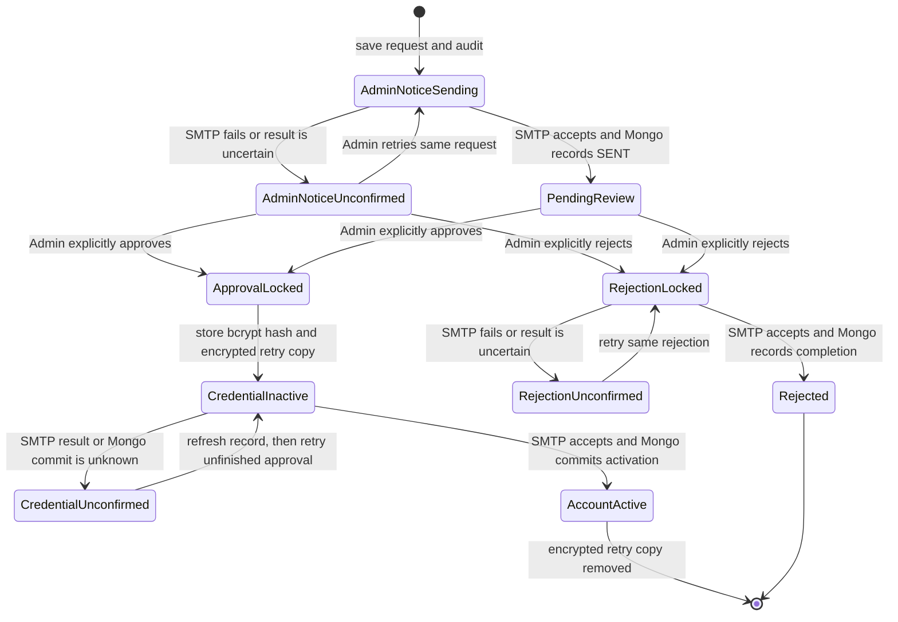

# Identity onboarding research and decision

Reviewed 19 November 2026. Keep the fixed bilingual emails and Gmail SMTP for this low-volume demo, subject to a successful send from the deployed application. The Admin authorizes issuance. The recipient proves access to the credential by signing in. An applicant's name and email alone establish neither employment nor account ownership. [Identity setup and approved email text](IDENTITY-SETUP.md)

## Onboarding patterns and their limits

| Product | Documented behavior | Decision for NSClub |
| --- | --- | --- |
| Google Workspace | With a verified domain, an authorized administrator can create the user and share a welcome message with a reset link valid for 48 hours. With an email-verified team, the invitee signs in at the invited address and creates a password. | Keep provisioning under the Admin session. A managed identity with a user-chosen password is the appropriate next design for an employer. [Google Workspace user management](https://knowledge.workspace.google.com/admin/users/add-an-account-for-a-new-user) |
| Microsoft Entra B2B | A guest's consent state begins at `PendingAcceptance`. An inviter can resend a pending invitation. The guest signs in and consents before the state becomes accepted. Tenant invitation permissions are configurable. | Track the Admin decision, transport outcome and recipient login separately. [Inviting external guests](https://learn.microsoft.com/en-us/entra/external-id/add-users-administrator) · [Invitation redemption](https://learn.microsoft.com/en-us/entra/external-id/redemption-experience) |
| GitHub organizations | Email invitations require a matching verified address. Pending invitations expire after seven days, and an owner can retry or cancel. | Expose explicit retry and its target in Admin. Here the link opens the same private page for everyone, so there is no invitation bearer token to expire or redeem. [GitHub organization invitations](https://docs.github.com/en/organizations/managing-membership-in-your-organization/inviting-users-to-join-your-organization) |
| Hugging Face Hub and Spaces | The Hub Members page can approve or reject pending join requests. Spaces OAuth authenticates an existing Hugging Face account and can restrict access by organization. | The Members page is directly relevant to the review UI. Requiring an HF identity would change who can use this Gmail-based demo. Neither guide supplies evidence about SMTP retry or Inbox delivery. [Hub membership](https://huggingface.co/docs/hub/organizations-managing) · [Spaces sign-in](https://huggingface.co/docs/hub/spaces-oauth) |

## What the open-source tests establish

- **Keycloak 26.4.7.** In `executeActionsEmail`, the server requires user-management permission, validates the actions and redirect, creates a token with a lifespan, sends its email, then records an Admin event. The test `sendResetPasswordEmailSuccessTwoLinks` requests two emails and checks for two events and two messages in a test SMTP server. Each link works once, and reopening it leads to an error. This separates replay protection from send deduplication. NSClub uses server authorization and an audit per attempt. It keeps decisions off email links altogether. [Apache-2.0 license](https://github.com/keycloak/keycloak/blob/38c38721ad4c1303fa2a1bc24ccece4799a8a242/LICENSE.txt) · [UserResource.java](https://github.com/keycloak/keycloak/blob/38c38721ad4c1303fa2a1bc24ccece4799a8a242/services/src/main/java/org/keycloak/services/resources/admin/UserResource.java#L1019-L1054) · [UserEmailTest.java](https://github.com/keycloak/keycloak/blob/38c38721ad4c1303fa2a1bc24ccece4799a8a242/tests/base/src/test/java/org/keycloak/tests/admin/user/UserEmailTest.java#L335-L373)
- **authentik 2025.10.0.** The invitation model records its creator, optional flow and single-use setting. The API sets the creator from the authenticated request. The stage checks the selected flow and deletes a single-use invitation when applied. Tests verify an incorrect flow is refused, the used record disappears, and creation is attributed to the authenticated actor. Adopt actor attribution and keep the NSClub request after a decision for audit and recovery. The inspected Python modules fall under MIT. The repository license gives different terms for the website, enterprise tree and third-party components. [License](https://github.com/goauthentik/authentik/blob/f2805b9b8ab423f35d6b2276e72b77594e5fb681/LICENSE) · [Model](https://github.com/goauthentik/authentik/blob/f2805b9b8ab423f35d6b2276e72b77594e5fb681/authentik/stages/invitation/models.py#L49-L73) · [API](https://github.com/goauthentik/authentik/blob/f2805b9b8ab423f35d6b2276e72b77594e5fb681/authentik/stages/invitation/api.py#L70-L76) · [Stage](https://github.com/goauthentik/authentik/blob/f2805b9b8ab423f35d6b2276e72b77594e5fb681/authentik/stages/invitation/stage.py#L35-L75) · [Tests](https://github.com/goauthentik/authentik/blob/f2805b9b8ab423f35d6b2276e72b77594e5fb681/authentik/stages/invitation/tests.py#L102-L173)

## Request, delivery and recovery

The public route returns the same HTTP 202 and body for a valid new address, a pending request and an active account. The public route saves the request and submission audit, then schedules the first Admin notice through Next.js `after`. A slow SMTP call no longer delays the public response for a new address. Database and network timings can still vary. A duplicate keeps the original name and creates no additional Admin notice. Registration and login apply limits by client and normalized address or login ID. Unknown-account login also performs a bcrypt comparison. The issued five-digit password remains usable after login. The session expires independently. Five decimal digits provide just 100,000 possible values, so offline guessing remains a risk even with a salted hash. [Password login](../src/services/password-auth.ts) · [OWASP authentication guidance](https://cheatsheetseries.owasp.org/cheatsheets/Authentication_Cheat_Sheet.html#authentication-and-error-messages)

The link in the Admin notice opens `/identity/review` with no side effect. An authenticated Admin's same-origin POST records the first decision, then only that decision can be retried. Each send attempt claims a two-minute processing lease. Its completion writes require the same lease, so an old callback cannot overwrite the state of a newer attempt. The private audit ties an actor and action to the request. A mail scanner or a forwarded page link conveys no authority. [RFC 9110 §9.2.1 on safe methods](https://datatracker.ietf.org/doc/html/rfc9110#section-9.2.1) · [Account request service](../src/services/account-requests.ts)

`finalDecision` distinguishes approval from rejection in the existing storage schema. `notificationStatus=SENT` records SMTP acceptance. A timeout after the last SMTP data byte may follow actual acceptance. If the Mongo commit reply is lost, even the activation outcome can be unknown to that caller. Refresh the same request before retrying. A completed approval already includes activation, audit and removal of the encrypted retry copy in one transaction. An unfinished approval can be resumed with the saved credential. Retrying may produce a second email. [SMTP final DATA timeout](https://datatracker.ietf.org/doc/html/rfc5321#section-4.5.3.2.6) · [MongoDB transaction error handling](https://www.mongodb.com/docs/drivers/node/current/crud/transactions/#transaction-errors)

The pending account has a bcrypt hash and an AES-256-GCM envelope with a random 12-byte IV and 16-byte tag. Keep the secret key separate from Mongo and preserve it while credentials remain pending. A hash cannot reconstruct the mailed password. For a record with an envelope, retry checks authenticated decryption, the five-digit format and the saved hash. A wrong key, damaged envelope or mismatched hash stops the send and preserves the record. Restore the matching key or known-good backup before retry. For a legacy inactive account linked to the same request and lacking the envelope field entirely, the application saves one replacement, records the replacement in the audit and sends that credential. Any earlier message for that legacy account may contain an obsolete password. Activation removes the envelope. [Credential implementation](../src/lib/identity-credentials.ts) · [OWASP cryptographic storage and key management](https://cheatsheetseries.owasp.org/cheatsheets/Cryptographic_Storage_Cheat_Sheet.html#key-management)

## Transport decision

| Option | Access, implementation and operating cost | Decision |
| --- | --- | --- |
| Gmail SMTP with App Password | Uses the existing sender and Nodemailer adapter. The owner needs 2-Step Verification. Security-key-only setups, organizational policy or Advanced Protection can make App Passwords unavailable. Changing the Google Account password revokes them. | Keep for the demo if the designated mailbox supports it. The owner stores a dedicated, revocable secret in Vercel. [Google App Passwords](https://support.google.com/accounts/answer/185833?hl=en) · [Vercel SMTP](https://vercel.com/kb/guide/serverless-functions-and-smtp) |
| Gmail SMTP with OAuth | Reuses MIME and SMTP code but adds a Google OAuth client, consent, refresh-token storage and a recovery path if consent is revoked. SMTP XOAUTH2 requires the broad `https://mail.google.com/` scope. | Possible for an existing approved OAuth deployment. Granting full mailbox access for a sender-only app weighs against this choice. [Google XOAUTH2 protocol](https://developers.google.com/workspace/gmail/imap/xoauth2-protocol#oauth_20_scopes) · [Offline access](https://developers.google.com/identity/protocols/oauth2/web-server#offline) |
| Gmail API with OAuth | Requires an enabled Cloud API and consent. `gmail.send` permits sending without inbox access. `messages.send` takes base64url-encoded MIME and costs 100 quota units. A 429 may carry a retry time. | Prefer this fallback if App Passwords are unavailable and narrow authorization matters. It requires an adapter and token lifecycle work. Preserve the request and delivery state regardless of transport. [Scopes](https://developers.google.com/workspace/gmail/api/auth/scopes) · [Sending guide](https://developers.google.com/workspace/gmail/api/guides/sending) · [Quotas and billing threshold](https://developers.google.com/workspace/gmail/api/reference/quota) · [Error handling](https://developers.google.com/workspace/gmail/api/guides/handle-errors) |

Google's consumer help lists more than 500 emails in a day as a possible limit. Workspace lists 2,000 messages per rolling 24 hours, or 500 on trial accounts, with separate recipient limits. Switching transports retains the sender's shared daily limits. The Gmail API also has project and user rate quotas and a daily billing threshold. One straightforward approval sends two messages, one to the Admin and one to the applicant. An equivalent Gmail API flow would consume 200 send quota units, before any retries. At demo volume, the practical costs are mailbox operation, function usage and incident handling. Actual charges depend on the existing plans and total usage. [Personal Gmail limits](https://support.google.com/mail/answer/22839?hl=en) · [Workspace limits](https://knowledge.workspace.google.com/admin/gmail/gmail-sending-limits-in-google-workspace) · [Gmail API quotas](https://developers.google.com/workspace/gmail/api/reference/quota)

Vercel Node.js Functions can submit on 465 (implicit TLS) or 587 (STARTTLS). NSClub requires STARTTLS on 587. The function must track the promise through completion. A registered Next.js `after` callback can do that after the public response, within the deployment's function duration. A stopped callback still requires durable request state and an Admin retry. Vercel Fluid compute meters active CPU, provisioned memory and invocations according to plan. Waiting for SMTP does not accrue active CPU time. [Vercel SMTP](https://vercel.com/kb/guide/serverless-functions-and-smtp) · [Next.js 15 after](https://nextjs.org/docs/15/app/api-reference/functions/after) · [Function duration](https://vercel.com/docs/functions/configuring-functions/duration) · [Fluid compute pricing](https://vercel.com/docs/functions/usage-and-pricing)

## Operational evidence

For the designated existing request, record the Admin notice's subject, time and mailbox folder, then the Admin decision, the applicant message's subject, time and folder, and the applicant's successful sign-in and access to the support form. Record Inbox and Spam distinctly. Use the sender's authorized From address and TLS. For a custom sending domain, check its Gmail sender authentication requirements before investigating Inbox placement. Keep credentials out of logs and screenshots. A test SMTP server, a provider acceptance event and a browser test with synthetic identity each answer different questions. Bulk delivery, an unattended retry worker and organization SSO are deferred for this manually reviewed demo. [Google email sender guidelines](https://support.google.com/a/answer/81126?hl=en) · [Deployment and mailbox checks](IDENTITY-SETUP.md) · [Account request tests](../tests/account-requests.test.ts)
