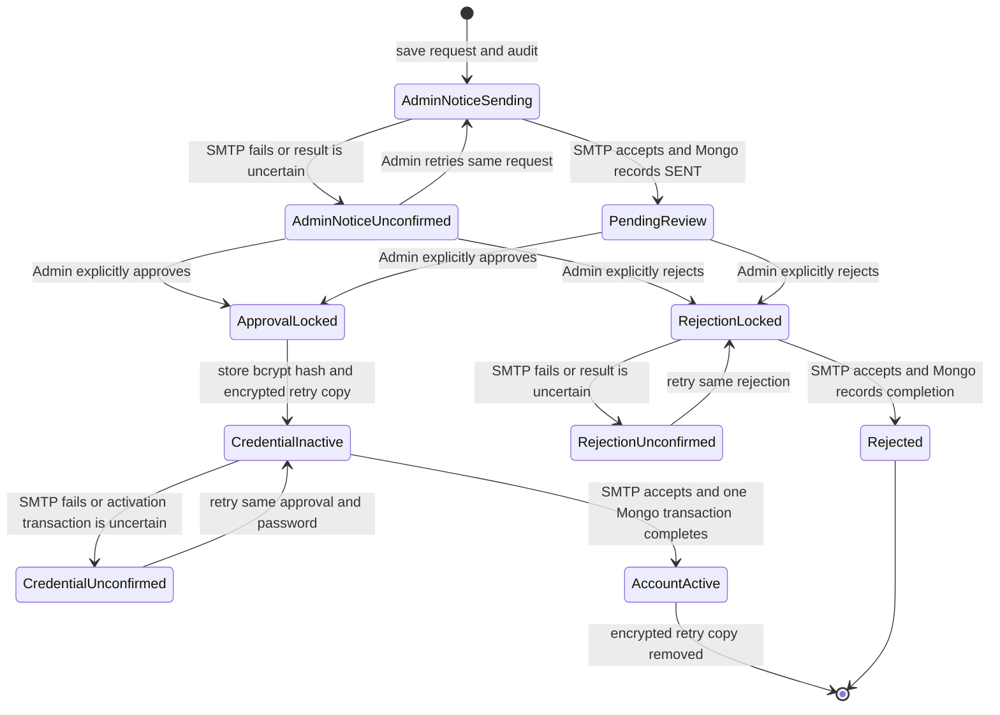

# Identity onboarding research and decision

Reviewed 19 November 2026. This note compares managed identity onboarding with the demo account flow in NSClub Help Desk. It records implementation patterns, not production IAM approval.

## Patterns from managed platforms

| Platform | Verified pattern | Application to this demo |
| --- | --- | --- |
| Google Workspace | A user with the appropriate user-management privilege adds an account or sends an invitation in Admin Console. An invitee follows the message and creates their own password. The admin can review or cancel pending invitations. | Keep account creation and review behind an authenticated Admin. For real employees, use Workspace or Cloud Identity and avoid sending a reusable password. [Google Workspace user management](https://knowledge.workspace.google.com/admin/users/add-an-account-for-a-new-user) |
| Microsoft Entra B2B | An administrator invites an external identity through the admin center, PowerShell or Graph. The invitee redeems the invitation using their own credentials. The documented flow can resend an invitation or reset redemption status. | Prefer invitation and credential ownership by the user when moving beyond a demo. Do not copy a password-sharing flow into an organizational identity system. [Entra B2B internal user invitations](https://learn.microsoft.com/en-us/entra/external-id/invite-internal-users) |
| GitHub Organizations | Organization owners send an invitation by username or email. Email invitations must match a verified GitHub address. Pending invitations expire after seven days and can be retried or cancelled. | Use explicit role-gated actions, a pending state, and a bounded retry path. The demo does not need a seven-day invitation token because its email link only opens the Admin list. [GitHub organization invitations](https://docs.github.com/en/organizations/managing-membership-in-your-organization/inviting-users-to-join-your-organization) |

## Open-source implementations inspected

| Repository and license | Source inspected | Reusable pattern | Not copied |
| --- | --- | --- | --- |
| [Keycloak](https://github.com/keycloak/keycloak), Apache-2.0 in the root `LICENSE.txt` | [`UserResource.java`](https://github.com/keycloak/keycloak/blob/main/services/src/main/java/org/keycloak/services/resources/admin/UserResource.java), `executeActionsEmail` | The Admin API checks `requireManage`, validates action parameters, creates a time-bounded action token, sends a link for the user to complete required actions, and records an Admin event. | The demo keeps its approved five-digit credential email. Keycloak's action-token and required-action infrastructure is not equivalent to this application, and code was not copied. |
| [authentik](https://github.com/goauthentik/authentik), MIT for the main repository, with separate terms for `website/` and `authentik/enterprise/` | [`models.py`](https://github.com/goauthentik/authentik/blob/main/authentik/stages/invitation/models.py), [`api.py`](https://github.com/goauthentik/authentik/blob/main/authentik/stages/invitation/api.py), [`stage.py`](https://github.com/goauthentik/authentik/blob/main/authentik/stages/invitation/stage.py) | Invitations are first-class records with expiry, creator, optional single-use behavior, optional flow restriction, and fixed enrollment data. The API associates newly created invitations with the authenticated user and sends the selected flow link. | The demo has no enrollment token or invitation workflow. No authentik code was copied. Review the root license and its directory-specific exceptions before reusing any code or assets. |

## Link scanners, retries and audit

The email sent to the Admin links to `/identity/review`, which is a read-only page load. It has no approval token and no state change on `GET`. The decision and notification-retry endpoints are `POST` routes that require a same-origin request and an Admin session. This avoids mail scanners accidentally approving or rejecting an account.

The first Admin decision is locked before sending the result. A failed or uncertain email can only retry that same decision. An approval keeps the account inactive until the mail call succeeds and one Mongo transaction marks the account active, completes the request, removes the encrypted retry copy and writes the audit entry. If SMTP may have accepted the email but the database transaction fails, retry sends the same password. SMTP can accept a message more than once, so duplicate messages are possible, but the account and active password remain singular.

The Admin notice uses the same request record and ID for retries. Email status `SENT` means the SMTP server accepted the message. It does not claim that the message reached the recipient's inbox. A timeout or database error can leave delivery unconfirmed, so the UI says *unconfirmed* and keeps the account inactive when credential activation is not recorded.

The public application endpoint returns the same HTTP `202` and response body for a new address, a pending request and an active account. It does not return an existing request ID or status, overwrite the pending name, or resend the Admin notice. Client and normalized-email rate limits still apply. This keeps duplicate submissions idempotent at the application boundary and avoids using the form to enumerate account addresses.

## Request and delivery state machine

`status` retains the earlier `PENDING` / `APPROVED` storage contract. `finalDecision` records the actual Admin choice, and `notificationStatus` records SMTP acceptance or an unconfirmed outcome. The read-only email link never advances this machine.

The first approve/reject choice is immutable once claimed. `CredentialInactive` is `PENDING_DELIVERY`, and the credential envelope is removed only when the request is completed and the account becomes `ACTIVE` in the same transaction. If SMTP accepts a message but Mongo cannot record completion, the app can send a duplicate email on retry, but it uses the same credential and cannot create another account. `AdminNoticeUnconfirmed`, `CredentialUnconfirmed` and `RejectionUnconfirmed` remain visible in the Admin list and expose only the matching retry action after the processing lease expires.

## Gmail and Vercel delivery options

| Option | Requirements and trade-offs | Decision |
| --- | --- | --- |
| Nodemailer with Gmail SMTP App Password | Fits the existing server-only Nodemailer adapter. Google requires 2-Step Verification for an App Password, describes it as less secure than Google sign-in, and may hide the option for some account types. Gmail supports authenticated SMTP on 465 or 587. | Keep the current SMTP implementation for this low-volume demo if the sender account permits an App Password. Store it only in Vercel Production secrets. |
| Nodemailer with Gmail SMTP OAuth 2.0 | Gmail SMTP supports OAuth 2.0 SASL XOAUTH2. It avoids an App Password but requires a Google OAuth client, consent/grant, refresh-token handling and rotation. | A compatible fallback if the sender account cannot use an App Password. This still uses the current SMTP transport. |
| Gmail API `messages.send` with OAuth | Requires enabling the API, OAuth consent and credentials, MIME construction and base64URL encoding, token storage/refresh, plus Gmail API quota handling. Google documents the `messages.send` method and `gmail.send` scope. | Do not migrate just to replace SMTP. It adds configuration and token lifecycle work without solving inbox delivery or eliminating Gmail's sending limits. |

Vercel Node.js Functions allow authenticated SMTP on ports 465 and 587 and block outbound port 25. Vercel requires the send promise to finish before the function returns, and retries are application-owned. The current mailer awaits Nodemailer's `sendMail`, and the service now retains retry state in MongoDB. Gmail currently documents a rolling daily limit of 500 messages for personal or trial accounts and 2,000 for paid Workspace accounts, shared across clients using that mailbox. These limits are far above this demo's expected volume but remain account policy, not an application guarantee.

## Selected design

Keep Nodemailer and the current fixed bilingual templates. Keep decision links non-mutating and Admin review explicit. Store only the bcrypt password hash for an active account. While an approved account is inactive, store a separate AES-256-GCM encrypted copy of the temporary password so an ambiguous retry can resend the exact same string. The key is `IDENTITY_CREDENTIAL_ENCRYPTION_KEY`, a stable server-only 32-byte base64 value. Remove the encrypted copy in the same database transaction that activates the account.

The demo password is a string matching `^\d{5}$`, including leading zeroes such as `00007`. It is intentionally weak and is not suitable for real employee accounts. For real onboarding, provision a managed identity or invite the employee to set their own password.

## Sources

- [Google Workspace: Add an account for a new user](https://knowledge.workspace.google.com/admin/users/add-an-account-for-a-new-user)
- [Microsoft Entra: Invite internal users to B2B collaboration](https://learn.microsoft.com/en-us/entra/external-id/invite-internal-users)
- [GitHub: Inviting users to join your organization](https://docs.github.com/en/organizations/managing-membership-in-your-organization/inviting-users-to-join-your-organization)
- [Google Account: Sign in with app passwords](https://support.google.com/accounts/answer/185833?hl=en)
- [Google: Gmail SMTP, IMAP and POP](https://developers.google.com/workspace/gmail/imap/imap-smtp)
- [Google: Create and send email messages with the Gmail API](https://developers.google.com/workspace/gmail/api/guides/sending)
- [Google: Gmail API quota](https://developers.google.com/workspace/gmail/api/reference/quota)
- [Vercel: Can I use SMTP with Vercel?](https://vercel.com/kb/guide/serverless-functions-and-smtp)
- [Keycloak repository license](https://github.com/keycloak/keycloak/blob/main/LICENSE.txt)
- [authentik repository license](https://github.com/goauthentik/authentik/blob/main/LICENSE)
